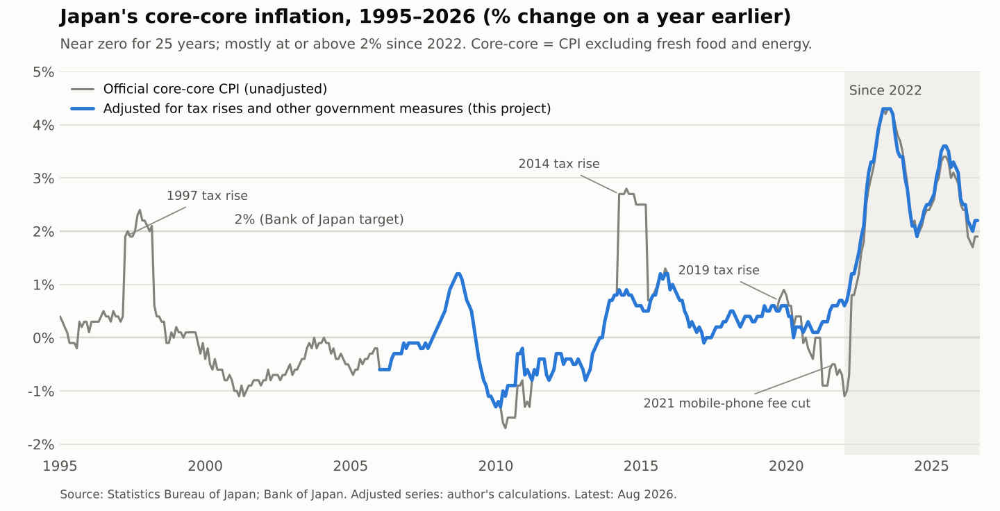

# Has Japan Entered a New Inflation Regime?

**Applying econometric and machine-learning models to forecasting Japanese inflation, 2007–2026**

> **Status (October 2026):** research design finished and all data collected; now building the inflation series. This repository is updated as the research goes on. Follow the progress in the [research log](docs/research_log.md).

## Project Overview

For about 25 years, Japan's prices barely moved, and at times they fell. Since 2022, core inflation has mostly stayed at or above 2%. I wanted to know whether this is a temporary shock or a real change, and what it means for anyone who has to forecast inflation.



Before my exchange I worked as a data-analysis intern, where I learned the data-science side of the work. This project is where I combine it with what I study: econometrics and time series. Research Paper I this course at Otaru University of Commerce gave me the chance to do it properly, with weekly supervision with Prof Ikeda.

## Reserach Quentions

The IMF (Liu, Pan and Xu, 2024, WP/24/206) notes that Japanese inflation has become harder to forecast, but does not test whether a lasting change has taken place. This project starts from that paper and asks:

1. **Diagnosis:** did Japan's inflation enter a new regime, and which economic explanations fit the evidence?
2. **Forecasting:** has inflation become harder to forecast, and which models and economic information help?
3. **Historical window:** does using more recent data improve forecasts?

## Approach

- **Inflation measure:** core-core CPI (excluding fresh food and energy), adjusted for one-off government measures, such as consumption-tax increases, that distort the underlying trend. It joins the Statistics Bureau's tax-adjusted series (to 2015) with the Bank of Japan's adjusted series (from 2016).
- **RQ1:** Bai–Perron structural-break tests, then four economic explanations from previous research: imported costs, firms' price-setting, wage–price feedback, and changes in economic relationships.
- **RQ2:** out-of-sample forecasts from 2013 at 1, 3 and 6 months ahead. Models: random walk, autoregressive (AR), AR plus one group of economic indicators, and LASSO (following the IMF). Forecasts use only data published at the time. Comparisons use Diebold–Mariano and Giacomini–Rossi tests.
- **RQ3:** expanding vs 10-year vs 5-year training windows.

## Repository structure

```
data/        raw and processed data (sources and licences in data/README.md)
src/         Python code
tests/       automatic checks
notebooks/   exploration and charts
results/     figures and tables
docs/        research log and methodology
```

## Reproducing the results

Python 3.13. On Windows:

```
py -3.13 -m venv .venv
.venv\Scripts\activate
pip install -r requirements.txt
```

Instructions for each analysis step will be added as the code is written.

## Data

All data come from official sources: the Statistics Bureau of Japan, the Bank of Japan, the Cabinet Office, the Ministry of Health, Labour and Welfare and others.In [data/README.md](data/README.md). Raw files are kept unchanged.

## About Me

Undergraduate research paper by **Tay Tze Ping**, supervised at Otaru University of Commerce (OUC), Japan, for Research Paper I. I am on exchange from the University of Malaya (Economics, Applied Statistics), October 2026 to February 2027.

## Licence

Code: MIT (see `LICENSE`). Data remain under their original licences (see `data/README.md`).
